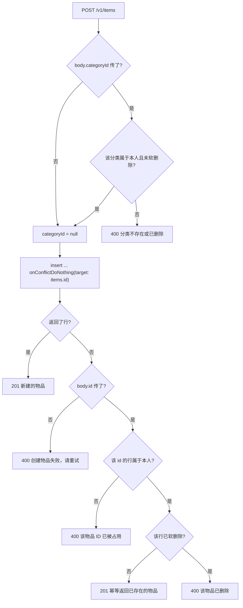

# feat: 物品模块接口（items module）

**目标仓库：** yadoI_be（本文档所在仓库）。文中所有路径均为本仓库相对路径。产品侧依据来自同级的 iOS 仓库 `yadoI`，引用时会显式标注。

## Summary

`yadoi.items` 表与迁移已经就位，但 API 层还没有物品模块 —— `src/modules/` 下只有 `categories/`，`src/app.ts` 只挂了 `/v1/categories`。本计划补齐 `src/modules/items/`，提供列表、创建、更新、软删除四个接口，全部进入 `openapi.json` 契约供 iOS 生成网络层。

数据表字段口径不动，本次是纯 API 层工作。做法严格镜像分类模块：`schemas.ts` 定契约、`routes.ts` 定路由、`requireAuth` 挂在 `createRoute` 的 `middleware` 上、错误统一走 `AppError`、删除只写 `deletedAt`。

有两处分类模块没有而物品必须处理的新问题：物品表带 `category_id` 外键和 `items_icon_pair_ck` 检查约束，违反时会变成 500，必须在契约层与显式校验里拦成 400；物品的可选字段大多可空，PATCH 需要把「不传 = 不改」和「传 null = 清空」区分开。

---

## Problem Frame

iOS 端已经做好了添加物品的入口与表单（`AddItemFlowView` / `AddItemFormView`），但保存按钮仍是占位实现 —— 其 FIXME 注明的直接阻塞是「本地存储（SwiftData / iCloud 同步）尚未接入」，物品的网络层也同样没有。**因此本计划落地后保存按钮不会自动生效**，iOS 侧的数据层要单独接（见 Scope Boundaries）。后端这一侧缺的不是数据模型而是 API 层，本计划补的是这一环：分类已经有 `CategoryService` 在调真接口，物品还没有对应的服务端契约可对接。

同时存在一个跨模块的结构障碍：分类模块把 `ErrorSchema`（注册为 OpenAPI 组件名 `Error`）和 `jsonError()` 写在了 `src/modules/categories/routes.ts` 内部。AGENTS.md 规定模块之间不互相 import，需要复用的逻辑下沉到 `shared/`。若物品模块各自再声明一份同名 `Error` 组件，两个不同的 schema 实例会以同一个组件名注册进 OpenAPI registry —— 生成器要么报错，要么静默让先注册的那份胜出，后者更危险，因为 `openapi.json` 是与客户端之间的契约而这种覆盖不产生任何异常。所以这次要先把这份定义下沉。

---

## Requirements

| ID | 需求 | 来源 |
| --- | --- | --- |
| R1 | 客户端只传名称即可创建一件物品，其余字段允许后补 | iOS 仓库 `docs/prd/v1-product-requirements.md` 8.2 空状态、10.1 |
| R2 | 创建接口幂等：允许客户端生成并传入 `id`，重复提交同一 id 返回已存在的记录而非报错 | AGENTS.md「接口约定」 |
| R3 | 客户端能一次拉取本人全部未删除物品，不做增量同步 | AGENTS.md「接口约定」 |
| R4 | 客户端能部分更新物品字段，并能显式清空可空字段 | PRD 10.1「物品的基础新增、查看、编辑和删除能力」 |
| R5 | 删除为软删除，重复删除同一物品幂等返回 | AGENTS.md「数据库约定」 |
| R6 | 所有查询按 `userId` 过滤，用户标识只来自 JWT，不接受客户端传入 | AGENTS.md「安全红线」 |
| R7 | 创建与更新时拒绝指向他人或已软删除分类的引用（并发窗口下的残余情况见 Risks） | `docs/compound.md`「软删除项目里，外键的级联规则永远不会触发」 |
| R8 | 四个接口全部用 `app.openapi()` 定义，进入 `openapi.json` 契约 | AGENTS.md「接口约定」 |

---

## Key Technical Decisions

**KTD1 — 把 `ErrorSchema` 与 `jsonError()` 下沉到 `src/shared/openapi.ts`，分类模块改为引用。**
模块之间不许互相 import，而两个模块各自注册同名 `Error` 组件会在 OpenAPI registry 里撞车。下沉到已有的 `shared/openapi.ts`（本身就是 OpenAPI 相关的共享模块）后全局只有一个实例，冲突从结构上消失。这是本次唯一一处必须先改既有代码的地方。

**KTD2 — 不下沉 `isUniqueViolation()` 等 Postgres 错误码嗅探逻辑。**
分类模块需要它是因为 `categories_user_name_uniq` 唯一索引；物品表除主键外没有任何唯一索引（同名物品是合法的，用户可以拥有两个一样的杯子），主键冲突已由 `onConflictDoNothing({ target: items.id })` 覆盖，物品模块用不到。只用一次的东西不做抽象。

**KTD3 — 图标在契约里用嵌套对象 `icon: { type, value } | null`，而不是两个平铺字段。**
表上有 `items_icon_pair_ck` 约束要求 `icon_type` 与 `icon_value` 同时为空或同时非空。若契约暴露两个独立可选字段，PATCH 里只改其中一个就会违反约束、变成 500；用 `.refine()` 补救在部分更新场景下还得先读当前行。嵌套成一个整体后，「成对」由数据结构保证，PATCH 也只能整体替换或整体清空，非法状态无法表达。代价是 DTO 形状与数据库列不是一一对应，需要在 `toItemDTO()` 里显式组装。
备选方案是平铺两字段 + `.refine()` 校验，已否决：它把一个能用类型消灭的错误留到了运行时。

**本期契约的 `type` 只接受 `'emoji' | 'preset'`，不含 `'photo'`。** 图片上传与对象存储本期不做，若契约先把 `photo` 放出去，客户端会拿它接相册选图并往 `value` 里写本地路径或 base64，服务端既不实现也无从校验，只能原样存库，等真做对象存储时这批数据必须迁移。给生成式客户端的枚举加值是向后兼容的加法，能力落地再加没有代价，提前留位才有代价。数据库 `icon_type` 列不变，仍可容纳 `photo`。

**KTD4 — PATCH 用「字段不出现 / 传 `null` / 传具体值」三态语义。**
物品的可选字段大多可空（备注、金额、日期、分类、图标），客户端需要能把填错的金额清空，而不只是改成别的值。Zod 侧用 `.nullable().optional()` 表达，处理器侧靠 `!== undefined` 判断是否参与更新。不可空字段（名称、状态、是否收藏）只接受「不出现」或「具体值」。

**KTD5 — 创建与更新时显式校验分类归属，失败返回 400；不为并发窗口加锁。**
外键只保证被引用的分类行存在，不保证它属于当前用户、也不保证它没被软删除。而 `docs/compound.md` 记录的那次 bug 正是悬挂分类引用。因此传了 `categoryId` 时必须先查一次：属于本人且 `deletedAt is null` 才放行，否则 `badRequest('分类不存在或已删除')`。用 400 而非 404，因为这是请求体里的参数非法，不是请求路径指向的资源不存在。

这次查询到随后写入之间存在 check-then-act 窗口：并发的分类删除事务里那句「把该分类下物品置为未分类」看不到这条尚未提交的新物品，于是仍可能留下一条指向已软删除分类的物品。**本期不为此加事务行锁**：个人物品量级下这个窗口极窄，而给每次物品写入都锁住分类行的代价不成比例；客户端遇到 `categoryId` 查不到对应分类时按「未分类」兜底展示即可。R7 的措辞据此收窄为「拒绝非法的请求参数」，而不是承诺任何并发下都不产生悬挂引用 —— 承诺做不到的事比不承诺更糟。

**KTD6 — 列表不接受任何查询参数，一次返回全量。**
AGENTS.md 已定调：列表一次返回全量、客户端整体替换本地数据。既然客户端手里有全量数据，PRD 里物品页的搜索、分类/状态筛选、排序都在本地完成，服务端加过滤参数只是把同一件事做两遍。排序按 `updated_at` 倒序（命中既有的 `items_user_updated_idx` 索引），并以 `id` 兜底保证顺序稳定可复现。

**KTD7 — 不做跨字段的状态一致性校验。**
表注释说明「卖出金额仅在 status 为 sold 时有意义」，但把它做成校验规则在 PATCH 下代价不成比例：部分更新时得先读当前行才知道组合后的状态，而误伤的场景（先填卖出价再改状态）是正常操作顺序。本期只校验单字段合法性，卖出信息在非 sold 状态下不展示由客户端负责。

---

## High-Level Technical Design

以下为方向性设计，不是实现规格。

### 创建接口的判定路径

幂等创建叠加分类归属校验后分支较多，先把判定顺序固定下来：

`N` 这一层是分类模块没有的：它的归属查询不过滤 `deletedAt`，直接走到幂等返回，会把墓碑行当成功结果发回客户端。

分类校验放在插入之前：若放在之后，非法分类会先写进库再回滚，事务边界反而更麻烦。

### PATCH 的字段三态语义

| 请求体中的字段 | 含义 | 适用字段 |
| --- | --- | --- |
| 不出现 | 不修改 | 全部字段 |
| `null` | 清空为 NULL | `categoryId`、`icon`、`note`、`purchasePrice`、`salePrice`、`purchasedAt`、`soldAt`、`warrantyUntil` |
| 具体值 | 覆盖为该值 | 全部字段 |

`name`、`status`、`isFavorite` 在表上是 `notNull`，契约里不接受 `null`，传了由 Zod 拦成 400。

---

## Implementation Units

### U1. 下沉共享的 OpenAPI 错误响应定义

**Goal** 把 `ErrorSchema` 与 `jsonError()` 从分类模块搬到 `src/shared/openapi.ts`，让物品模块能复用同一个实例。

**Requirements** R8（KTD1）

**Dependencies** 无

**Files**
- `src/shared/openapi.ts`（修改：新增导出 `ErrorSchema`、`jsonError`）
- `src/modules/categories/routes.ts`（修改：删除本地声明，改为 import）

**Approach** 纯搬移，不改结构和文案。`ErrorSchema` 保持 `.openapi('Error')` 的组件名不变，`jsonError(description)` 参数不变。分类模块删掉本地的 `ErrorSchema` / `jsonError` 声明后，检查 `z` 是否仍被其他代码使用，不再使用则一并清理导入（这是本次改动产生的孤儿导入，可以删）。

一处必要增补：`jsonError` 从模块私有的箭头函数变成 `shared/` 的导出函数后，AGENTS.md 的「导出的函数必须显式标注参数与返回值类型」与「声明级注释优先用 `/** */`」开始适用，需补上显式返回类型与中文注释。这不算改行为，但「纯搬移」不能理解成连这些也照抄。

**Patterns to follow** `src/shared/openapi.ts` 现有的 `createApp()` —— 同一个文件里已经在做「OpenAPI 层面的共享能力」这件事。

**Verification** 这是重构单元，判据是契约输出不变：改动前后 `openapi.json` 逐字节一致（做法是改动前先存一份，改完再取一次 diff）。不要用「`Error` 组件只有一份」当判据 —— `components.schemas` 是 JSON 对象，同名键结构上不可能出现两次，同名注册被静默覆盖时这条检查照样通过；逐字节 diff 才能暴露胜出的是哪一份。另外确认 `components.schemas.Error` 的属性仍恰为 `code` / `message` / `details`。

**Test expectation: none —— 无行为变更的纯搬移，判据由上面的契约对比覆盖。**

---

### U2. 物品模块数据契约

**Goal** 在 `src/modules/items/schemas.ts` 一次性定义物品的全部对外数据形状，作为校验、类型与 OpenAPI 文档的唯一来源。

**Requirements** R1、R2、R4、R8（KTD3、KTD4）

**Dependencies** 无

**Files**
- `src/modules/items/schemas.ts`（新建）

**Approach**
需要导出的形状：`ItemIdParamSchema`（路径参数）、`ItemIconSchema`、`ItemSchema`（DTO，注册组件名 `Item`）、`ItemListSchema`、`ItemCreateSchema`、`ItemUpdateSchema`、`ItemDeleteResultSchema`，以及 `ItemDTO` 类型。

约束取值：
- 状态枚举 `in_service` / `retired` / `sold`，snake_case 字符串，与表注释一致
- 名称上限 60 字符（物品名常含品牌加型号，比分类名的 30 长），`.trim().min(1)`
- 备注上限 2000 字符
- 金额对齐 `numeric(12, 2)`：非负，上限 `9_999_999_999.99`
- 日历日期（`purchasedAt` / `soldAt` / `warrantyUntil`）输出与接受 `YYYY-MM-DD`
- 图标按 KTD3 嵌套：`{ type: 'emoji' | 'preset', value: string }`，创建与更新时整体可空。**枚举本期不含 `'photo'`**（见 KTD3），传了由 Zod 拦成 400。图标内容要有长度上限（提取常量 `ICON_VALUE_MAX_LENGTH`，256 足够容纳单个 emoji 与素材库 key）—— `icon_value` 在表上是无长度限制的 `text`，而列表接口一次返回全量，缺上限等于让任意长度的字符串在每次拉取里被放大；这是本契约里唯一还没定上限的字符串字段
- `ItemIconSchema` **不要**调用 `.openapi('ItemIcon')` 注册成命名组件，只作为内联对象参与组合。`src/app.ts` 输出的是 `openapi: '3.0.0'`，而 OpenAPI 3.0 下 `$ref` 的同级关键字会被忽略，注册成组件后 `.nullable()` 表达的可空性会丢失或退化成 `allOf` 包裹，契约就把 icon 描述成必填非空对象 —— 而无图标是最常见的情形。这条是 KTD3 能否成立的前提，需在验证时实际检查 `openapi.json` 的输出，不能假定生成器行为
- `userId`、`createdAt`、`updatedAt`、`deletedAt` 一律由服务端所有，创建与更新请求都不接受。请求契约不要从 `ItemSchema` 派生 —— `Omit` 一把过来容易把这几个字段连带变成入参，能造出「出生即已删除」的物品，或让客户端自定创建时刻。分类模块的 `CategoryCreateSchema` 就是独立列举三个字段而非从 DTO 派生
- 创建请求的 `id` 可选（R2）；其余字段除 `name` 外全部可选，且可空字段（`categoryId`、`icon`、`note`、`purchasePrice`、`salePrice`、`purchasedAt`、`soldAt`、`warrantyUntil`）同样写成 `.nullable().optional()`，创建语境下 `null` 与「不出现」等价，都按未设置处理。若创建只接受「不出现」而更新接受 `null`，凡是把空值统一序列化成 `null` 的客户端都会在创建时踩 400，生成出来的两份模型可空性也不一致
- 更新请求全部字段可选，可空字段用 `.nullable().optional()`，并沿用分类模块的 `.refine()` 要求至少一个待更新字段

**Patterns to follow** `src/modules/categories/schemas.ts` —— 常量提取方式（`NAME_MAX_LENGTH`）、`.openapi({ description, example })` 的标注密度、组件命名、`z` 一律从 `@hono/zod-openapi` 导入。校验风格沿用现有的 `z.string().uuid()` / `z.string().datetime()` 写法而不是 Zod 4 的新短形式，保持两个模块一致。

**Test expectation: none —— 契约本身的行为由 U3–U6 的接口验证覆盖，此处不单独验证。**

**Verification** `pnpm run typecheck` 通过；`ItemDTO` 类型能覆盖 `ItemRow` 的全部对外字段（缺字段会在 U3 的 `toItemDTO()` 处暴露为类型错误）。

---

### U3. 物品列表接口与模块挂载

**Goal** 提供 `GET /v1/items`，并把物品子应用挂到 `/v1/items`，形成第一个可端到端验证的切片。

**Requirements** R3、R6、R8（KTD6）

**Dependencies** U1、U2

**Files**
- `src/modules/items/routes.ts`（新建）
- `src/app.ts`（修改：`app.route('/v1/items', itemsRoutes)`）

**Approach**
建立 `routes.ts` 骨架：`createApp()`、`toItemDTO(row)` 转换函数、列表路由。`toItemDTO` 负责三件转换：时刻字段 `toISOString()`；`icon_type` / `icon_value` 两列组装成嵌套 `icon` 对象（两者皆空时输出 `null`）；金额与日历日期按 drizzle 返回的类型直接透传。

查询条件 `and(eq(items.userId, userId), isNull(items.deletedAt))`，排序 `desc(items.updatedAt)` 加 `asc(items.id)` 兜底。响应形状 `{ items: [...] }`，与分类模块的 `{ categories: [...] }` 对齐。

不做分类模块那样的首次播种 —— 物品没有预置数据可播。

**Patterns to follow** `src/modules/categories/routes.ts` 的 `listRoute`：`createRoute` 里 `tags` / `summary` / `description` / `middleware: [requireAuth] as const` / `security: [{ Bearer: [] }]` / `responses` 齐备；`toCategoryDTO` 的转换写法。

**Verification 场景**（本地起服务实际打接口，见下方「验证策略」）
1. 无 `Authorization` 头请求 → 401，响应体为 `{ code: 'UNAUTHORIZED', message }`
2. 库中无该用户物品 → 200，`{ "items": [] }`
3. 手工插入两条物品（一条带分类与图标、一条全部可选字段为空）→ 200，两条都返回；带图标那条 `icon` 为嵌套对象，另一条 `icon` 为 `null`
4. 把其中一条的 `deleted_at` 置为当前时刻 → 200，列表只剩一条
5. 手工插入一条属于另一个 `user_id` 的物品 → 200，该条不出现在结果中（R6）
6. 两条物品的 `updated_at` 一先一后 → 较新的排在前
7. `openapi.json` 中出现 `GET /v1/items`，`components.schemas.Item` 已注册

---

### U4. 创建物品接口

**Goal** 提供 `POST /v1/items`，支持只传名称创建，支持客户端自带 id 的幂等重传，并拦住非法分类引用。

**Requirements** R1、R2、R6、R7、R8（KTD5）

**Dependencies** U3

**Files**
- `src/modules/items/routes.ts`（修改）

**Approach**
按 HTD 的判定图实现。新增模块内私有函数 `assertOwnedCategory(userId, categoryId)`：查一次分类表，要求 `id` 与 `userId` 同时匹配且 `deletedAt is null`，否则抛 `badRequest('分类不存在或已删除')`；U5 复用它。

插入用 `onConflictDoNothing({ target: items.id })` + `.returning()`。未返回行说明主键冲突，此时按三态处理，不要照抄分类模块的两态：

- 客户端没传 `id`：只可能是 `defaultRandom()` 撞车，概率上不会发生，抛 `badRequest('创建物品失败，请重试')` 作为防御分支
- 传了 `id`，按 `(id, userId)` 查到且 `deletedAt` 为空：这就是幂等要覆盖的正常情况（客户端离线提交后没收到响应而重传），201 返回已存在那条
- 传了 `id`，查到但 `deletedAt` 非空：抛 `badRequest('该物品已删除')`，与 U5 拒绝修改墓碑行的口径一致，**不做复活**。若照分类模块的写法直接 201 返回墓碑，客户端会拿到成功响应却在随后的全量列表里找不到这件物品，表现为「保存成功但物品消失」，并且很可能把这条幽灵数据写进本地库
- 传了 `id`，查不到：id 在别人名下，抛 `badRequest('该物品 ID 已被占用')`

注意分类模块的归属查询是 `and(eq(id), eq(userId))`，没有过滤 `deletedAt`，所以它有同一个洞（见 Deferred）。这里刻意不照抄。

图标从嵌套对象拆回两列写入，`icon` 为 `null` 或未传时两列都留空 —— 这样 `items_icon_pair_ck` 不可能被违反。

不需要 try/catch 捕获唯一约束冲突（KTD2）。

**Patterns to follow** `src/modules/categories/routes.ts` 的 `createCategoryRoute` 处理器 —— 幂等分支的结构、`badRequest` 文案风格、`201` 的用法（幂等返回也用 201，与分类一致）。

**Verification 场景**
1. 只传 `{ "name": "索尼相机" }` → 201，返回体 `name` 正确，`status` 为 `in_service`，`isFavorite` 为 `false`，`categoryId` / `icon` / 各金额日期为 `null`，`id` 为服务端生成的 UUID
2. 传 `{ "name": "" }` 或缺 `name` → 400，`code` 为 `BAD_REQUEST`
3. 传超过 60 字符的 `name` → 400
4. 客户端自带 `id` 首次提交 → 201，返回的 `id` 与传入一致
5. 同一 `id` 与相同内容重复提交 → 201，返回第一次创建的那条记录，数据库中仍只有一行（R2）
6. 同一 `id` 但内容不同地重复提交 → 201，返回的仍是首次创建的内容（幂等语义是「返回已存在的记录」，不是覆盖）
7. 用另一个用户已占用的 `id` 提交 → 400「该物品 ID 已被占用」，且不泄露对方物品的任何字段
8. 先用自带 `id` 创建、再删除该物品，然后用同一 `id` 重新提交创建 → 400「该物品已删除」，该行的 `deleted_at` 未被清空，也没有返回一条列表接口取不到的记录
9. 传本人的合法 `categoryId` → 201，`categoryId` 正确回显
10. 传不存在的 `categoryId` → 400「分类不存在或已删除」，数据库中未产生新行
11. 传属于另一个用户的 `categoryId` → 400（R7、R6）
12. 传本人但已软删除的 `categoryId` → 400（R7，`docs/compound.md` 那条经验的正面用例）
13. 传完整的 `icon: { type: 'emoji', value: '📷' }` → 201，回显为嵌套对象；数据库两列同时非空
14. 传 `icon: { type: 'emoji' }`（缺 `value`）→ 400，被契约层拦住而非落到数据库检查约束
15. 传 `icon: { type: 'photo', value: 'x' }` → 400，本期契约不接受 `photo`（KTD3）
16. 传超过 `ICON_VALUE_MAX_LENGTH` 的 `icon.value` → 400
17. 传 `purchasePrice: -1` → 400；传超出 `9_999_999_999.99` 的金额 → 400
18. 传 `purchasedAt: '2026-13-45'` → 400；传 `'2026-07-31'` → 201 且原样回显（不发生时区偏移，AGENTS.md 明确点过这个坑）
19. 传 `status: 'unknown_state'` → 400
20. 无 `Authorization` 头 → 401

---

### U5. 更新物品接口

**Goal** 提供 `PATCH /v1/items/{id}`，只更新请求中出现的字段，并支持把可空字段显式清空。

**Requirements** R4、R6、R7、R8（KTD4、KTD5）

**Dependencies** U4（复用 `assertOwnedCategory`）

**Files**
- `src/modules/items/routes.ts`（修改）

**Approach**
沿用分类模块 `updateRoute` 的结构：先 `findOwnedItem(userId, id)` 取当前行（不存在抛 404），已删除则 `badRequest('该物品已删除，无法修改')`；再逐字段构造 patch 对象，按 `!== undefined` 判断是否参与更新（因此 `null` 会被正常写入，实现清空语义）；`icon` 整体处理，传 `null` 则两列一起置空，传对象则两列一起写。

关键点：`isNull(items.deletedAt)` 必须下推到 `update` 的 `where`，不能只靠前置检查 —— 分类模块在这里留了注释说明原因（前置检查与更新之间存在时间差，并发删除会导致改到墓碑行）。更新返回空行时按并发删除处理。

**Patterns to follow** `src/modules/categories/routes.ts` 的 `updateRoute` 处理器，包括 `where` 下推那处注释所表达的约束。

**Verification 场景**
1. 只传 `{ "name": "新名字" }` → 200，`name` 变更，其余字段（含 `categoryId`、`note`）保持原值
2. 传 `{}` → 400（`.refine()` 要求至少一个待更新字段）
3. 已有 `note` 的物品传 `{ "note": null }` → 200，`note` 变为 `null`（R4 的清空语义）
4. 已有 `note` 的物品完全不传 `note` → 200，`note` 保持原值
5. 传 `{ "name": null }` → 400（不可空字段不接受 `null`）
6. 传 `{ "categoryId": null }` → 200，物品变为未分类
7. 传属于另一个用户的 `categoryId` → 400，物品未被修改
8. 传本人已软删除的 `categoryId` → 400（R7）
9. 传 `{ "icon": null }` → 200，`icon` 变为 `null`，数据库两列同时为空
10. 传 `{ "icon": { "type": "preset", "value": "camera" } }` 覆盖原有 emoji 图标 → 200，两列同时更新
11. 更新任意字段后 `updatedAt` 变新，`createdAt` 不变
12. 更新不存在的 `id` → 404
13. 更新另一个用户的物品 id → 404（R6，不区分「不存在」与「不属于你」，避免探测他人 id 是否存在）
14. 更新已软删除的物品 → 400「该物品已删除，无法修改」
15. 路径参数不是合法 UUID → 400
16. 无 `Authorization` 头 → 401

---

### U6. 软删除物品接口

**Goal** 提供 `DELETE /v1/items/{id}`，写入 `deletedAt` 而不物理删除，重复删除幂等返回。

**Requirements** R5、R6、R8

**Dependencies** U5（复用 `findOwnedItem`）

**Files**
- `src/modules/items/routes.ts`（修改）

**Approach**
镜像分类模块的 `deleteRoute`：先取当前行，已删除则幂等返回 200，否则用 drizzle 的 `sql` 模板把 `deletedAt` 置为 `now()`。响应形状 `{ item: ... }`，与分类的 `{ category: ... }` 对齐。

与分类删除的区别是不需要事务：目前没有任何表引用 `items`，没有引用需要清理。这一点要写成注释并点明前提 —— `docs/compound.md` 明确提示「将来新增引用 items 的表时，同样要在软删除路径里手写清理」，注释要让后来者知道这里的简单是有条件的。

**Patterns to follow** `src/modules/categories/routes.ts` 的 `deleteRoute`，包括幂等返回的处理方式。

**Verification 场景**
1. 删除本人一件物品 → 200，返回 `{ item: ... }` 且 `deletedAt` 非空
2. 删除后调用列表接口 → 该物品不出现（R5）
3. 删除后数据库中该行仍存在，`deleted_at` 非空（软删除，非物理删除）
4. 对同一物品重复调用删除 → 200，幂等返回同一条记录，`deletedAt` 保持首次删除的时刻不变
5. 删除不存在的 `id` → 404
6. 删除另一个用户的物品 id → 404，且对方数据未被修改（R6）
7. 删除一件带分类的物品 → 分类记录本身不受影响
8. 路径参数不是合法 UUID → 400
9. 无 `Authorization` 头 → 401

---

## 验证策略

本仓库没有测试框架（`package.json` 无 `test` script，无 vitest / jest 依赖），AGENTS.md 又规定不要自行安装新依赖。因此上面各单元列出的场景以**接口实测**方式执行，而非自动化测试：

1. `pnpm run typecheck` 与 `pnpm run build`（AGENTS.md 要求的最低门槛）
2. `pnpm run dev` 起服务，逐条打上面的场景。本地把 `.env` 的 `AUTH_DEV_BYPASS` 置为 `true` 可跳过 JWT，请求以 `AUTH_DEV_USER_ID`（默认 `dev-user-0001`）的身份进入；跨用户隔离类场景（U3-5、U4-7、U4-11、U5-7、U5-13、U6-6）需要临时改这个值或直接用 SQL 造另一个 `user_id` 的数据（仓库有 `docker-compose.yml`，可用 `docker compose exec` 进 psql，或用 `pnpm run db:studio`）
3. 至少跑一次**不带** `AUTH_DEV_BYPASS` 的启动，确认无 token 时四个接口都返回 401 —— 免鉴权开关本身会掩盖鉴权中间件没挂上的错误
4. 取一次 `GET /openapi.json`，确认：返回 200（生成失败时 `app.doc()` 会把异常序列化成 500，这是能真正判定生成成功的信号）；四条路径都在；`components.schemas.Error` 的属性恰为 `code` / `message` / `details`；`Item`、`ItemCreate`、`ItemUpdate` 三处的 `icon` 都表达成「对象或 null」而不是裸 `$ref`（见 U2 那条硬约束）

这些场景是一次性人工验证，不会沉淀为回归资产。是否引入 vitest 见「Open Questions」。

---

## Scope Boundaries

### 本次不做

- **iOS 端接入。** 网络层、`AddItemFormView` 的保存落库、离线与错误态处理都不在本次范围。接口跑通后单独规划。两个前置条件要先记下来：（1）iOS 现有的 `CategoryUpdatePayload` 约定是「值为 nil 的字段不会出现在 JSON 中」（见 `CategoryModels.swift` 注释），这种写法只能表达「不修改」，永远发不出显式 `null`，所以 KTD4 的清空语义要求客户端引入区分「缺席 / null / 具体值」的三态包装类型，照抄分类的既有范式会让 R4 在客户端侧不可达；（2）见下一条的图片依赖。
- **表结构变更。** 字段口径以现有 `src/db/schema.ts` 为准，本次不生成任何迁移。
- **图片上传与对象存储。** 本期契约的 `icon.type` 不接受 `'photo'`（KTD3），对象存储 key 的能力一并不做。这一条是「iOS 端接入」的前置依赖而不是并列项：PRD 6.1「图片、名称和陪伴时间优先展示」、8.2「默认使用双列图片卡片」、10.1「最小记录支持图片、名称和分类」都把图片当作物品页的首要内容，所以本次交付后 iOS 物品页仍无法呈现 PRD 定义的图片网格。排期时图片能力应早于 iOS 物品页接入。
- **服务端筛选、搜索、排序与分页。** 见 KTD6。
- **跨字段状态一致性校验。** 见 KTD7。
- **测试框架。** 见「验证策略」与「Open Questions」。

### Deferred to Follow-Up Work

- **PRD 与数据表的字段差异（本期一律不补）。** iOS 仓库的 PRD 提到品牌、型号、开始使用日期、货币、当前估值，现有物品表都没有。已决定本期不补，接口按现有表落地。各条的影响：品牌与型号让 PRD 8.2 的「搜索覆盖名称、品牌、型号和分类」退化为名称加分类；货币对应 PRD 10.3 的 yadoA 同步预留原则「购入价格、当前估值、货币和状态分字段保存」，而 `purchase_price` 注释是「暂不记币种」，但 PRD 8.4 说 V1 只支持单一基础货币展示，所以不影响本期功能；**当前估值是 PRD 10.1 明列的 V1 必须包含项**（「统计页的……用户填写估值」与「购入价格与当前估值分开保存」），不可由现有列推导，表注释的取舍理由并未覆盖它 —— 它是这批里唯一有明确 V1 依据的字段，做统计页之前必须补上。补这批字段需要迁移加接口一起改，且会让 `openapi.json` 为客户端二次变更，单独规划。
- **分类模块创建接口的同一个洞。** `createCategoryRoute` 的幂等归属查询是 `and(eq(categories.id, ...), eq(categories.userId, ...))`，没有过滤 `deletedAt`，所以用一个已软删除的分类 id 重新提交创建会拿到 201 加一条墓碑记录，而列表接口取不到它。物品模块在 U4 里已避开（多一层软删除判断），分类模块的修法是同样的一个 `if`。本期不动它以免扩散范围，但这是个已知会导致「保存成功但数据消失」的缺陷，不要忘。
- **PRD 的状态口径比表更宽。** PRD 提到闲置、赠送、丢失等状态，表上只有 `in_service` / `retired` / `sold` 三态加独立的 `isFavorite`。统计页真要做时会需要这些取值。
- **统计接口。** PRD 有统计页，件数、购入总值、分类分布等汇总口径需要单独设计。
- **物品单条详情接口（`GET /v1/items/{id}`）。** 列表已返回全量字段，客户端本地就有详情数据，本期不需要。将来做分享或深链时再加。

---

## Open Questions

| 问题 | 现状与影响 | 何时需要决定 |
| --- | --- | --- |
| V1 物品数据以 iCloud 私有同步为准，还是以本服务端为准 | PRD 10.1 把「本地优先存储、iCloud 私有同步/备份」列为 V1 必须包含，PRD 8.4 又说 V1 不强制注册独立 Yado 账号，而本服务所有业务路由都要 Logto JWT 的 sub 作为 `userId`。本计划提供的是全量列表加覆盖式 PATCH，契约里没有版本号或 ETag；两份数据并存时后写方会静默覆盖先写方。这不是实现细节 —— 它决定接口是主链路还是备份链路、首次迁移怎么做、冲突怎么解，iOS 接入无法在它之前动工 | iOS 物品数据层规划启动前，早于本文列出的其他 Follow-Up |
| 是否引入 vitest | 现在没有测试框架，本计划的验证是一次性人工实测，不留回归资产。物品模块的幂等与权限分支是这个后端里最值得沉淀测试的部分，之后每加一个模块，人工验证成本线性上涨。引入需要装依赖，按 AGENTS.md 要由维护者确认 | 可在本计划完成后单独决定，不阻塞实现 |
| 是否补齐品牌、型号、开始使用日期、货币、当前估值 | 见 Deferred。本期一律不补，接口按现有表落地 | iOS 做物品详情、编辑页或统计页之前 |

---

## Risks & Dependencies

**`Error` 组件重名冲突（已由 U1 消除）。** U1 的首要依据是 AGENTS.md 的分层规则（模块之间不互相 import，复用逻辑下沉 `shared/`），这条独立成立、不依赖生成器行为。同名注册的后果本身没有实测过：可能是静默覆盖（先注册者胜出），也可能报错。静默覆盖更危险 —— 它不会有任何异常，只会让 `openapi.json` 里的 `Error` 变成另一个模块那一份，而客户端代码由它生成。所以 U1 的验证判据是逐字节 diff 而不是「组件是否存在」。

**数据库约束违反变 500。** 物品表有 `items_icon_pair_ck` 检查约束和 `category_id` 外键，都是分类模块没有的。前者由 KTD3 的嵌套契约从结构上排除，后者由 KTD5 的显式校验拦成 400。U4 的场景 9–13 就是针对这两条的验证。

**悬挂分类引用。** `docs/compound.md` 记录过这个 bug 的一次实际发生。这次的新增面是「创建或更新物品时引用一个已软删除的分类」，方向与上次相反但结果一样。KTD5 覆盖，U4-12 与 U5-8 验证。残余风险是 KTD5 末尾那个 check-then-act 窗口：并发的分类删除仍可能留下一条指向已软删除分类的物品。本期知情接受，不加锁；客户端按「未分类」兜底。若将来这个窗口造成实际问题，再改为在事务内用行锁锁住分类行后写入。

**drizzle 列类型的实际 TS 形状需在实现时确认。** `date()` 列与 `numeric(..., { mode: 'number' })` 的返回类型直接决定 `toItemDTO()` 怎么写。预期是 `date()` 返回 `'YYYY-MM-DD'` 字符串（正好对上 AGENTS.md 的输出要求，无需转换）、numeric 返回 `number`，但以 `pnpm run typecheck` 的结果为准，不要按预期硬写。

**依赖：数据库需已应用 `drizzle/0000_quiet_roughhouse.sql`。** 该迁移同时建 `categories` 与 `items`，若本地库是早期 `db:push` 的产物，先按 `docs/compound.md` 的补救办法处理，不要混用 `db:push`。

---

## Deferred to Implementation

以下留到写代码时定，现在定了也只是猜：

- 具体的私有函数命名（`findOwnedItem` / `assertOwnedCategory` 是意图描述，不是签名规定）
- 金额小数位的校验写法：优先用 `.multipleOf(0.01)` 拦住超过两位小数，避免数据库静默四舍五入；若 Zod 4 在浮点边界上出现误判（如 `19.99` 被拒），退回只做范围校验并接受数据库的舍入行为
- 日历日期字符串的校验写法：Zod 4 有字符串日期校验，但现有模块用的是 `z.string().datetime()` 这类旧短形式，实际取哪种以 typecheck 通过且风格与 `categories/schemas.ts` 一致为准
- `toItemDTO()` 中图标的组装细节，取决于上面那条 drizzle 类型确认的结果

---

## Sources & Research

未做外部调研：技术栈由 AGENTS.md 完全锁定（Hono + Drizzle + Zod v4，禁止引入新框架与新依赖），且同仓库的分类模块是这套写法上周刚写的直接范例，本地范例强于任何外部资料。

- `AGENTS.md` —— 接口约定（幂等创建、全量列表、必须用 `app.openapi()`）、安全红线（按 userId 过滤、`requireAuth` 挂在 `middleware` 字段而非 `app.use`）、数据库约定（软删除、枚举存 text 用 snake_case、日历日期用 date）、分层职责（模块间不互相 import）
- `src/modules/categories/routes.ts`、`src/modules/categories/schemas.ts` —— 本次镜像的范例，含幂等创建分支、`where` 下推的并发注意点、软删除幂等返回
- `src/db/schema.ts` —— 物品表字段口径与两条约束（`items_icon_pair_ck`、`category_id` 外键），以及注释里记录的产品取舍
- `docs/compound.md` —— 软删除下外键级联永不触发（悬挂引用 bug）、不可混用 `db:push`
- `src/shared/errors.ts`、`src/shared/openapi.ts`、`src/middleware/auth.ts`、`src/config/env.ts` —— `AppError` 体系、`defaultHook` 的校验错误转换、`requireAuth` 与 `AUTH_DEV_BYPASS` 的行为
- iOS 仓库 `docs/prd/v1-product-requirements.md` 8.2 / 9 / 10.1 —— 物品页主操作与最小记录要求、V1 必须包含的增查改删；同时也是本计划识别出字段口径差异的来源
